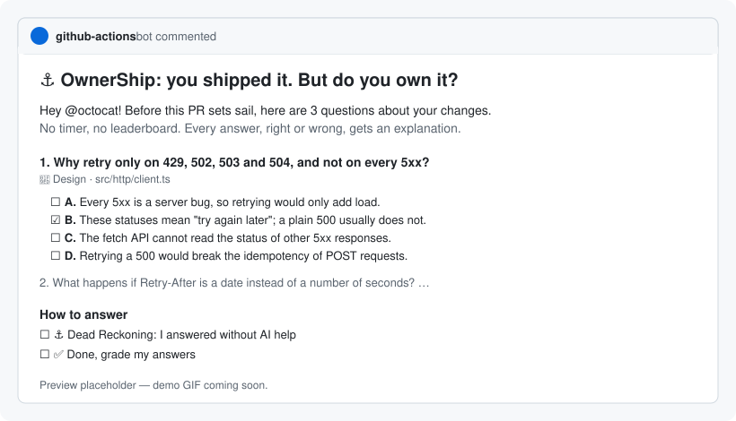

# ⚓ OwnerShip

**You shipped it. But do you own it?**

OwnerShip is a GitHub Action that asks the author of each pull request two or three friendly multiple-choice questions about their own changes: why this design, what happens when it fails, what else it touches. It grades the answers with kindness, explains the right ones, and hands out badges.

More and more code is written with AI. That is great, as long as the humans who ship it still understand it. OwnerShip keeps people in the loop the fun way: no timer, no leaderboard, no blocking check unless you ask for one. You bring your own model (an API key or a model you host), and everything lives in your repository and in GitHub.

<p align="center">
  
</p>

## How it works

1. **A PR is opened** (or marked ready for review). OwnerShip reads the diff, skips the noise (lockfiles, build output, generated code), and asks your model for questions about the _why_ and the _consequences_ of the change. Never trivia.
2. **The author answers** by ticking one box per question in the quiz comment, then **✅ Done**, whenever they like.
3. **OwnerShip debriefs**: every pick gets friendly feedback and an explanation of why the right option is right. The PR gets a badge label.

Prefer answers in the author's own words? Set `format: open`: answers are then a few sentences each, graded `solid`, `partial` or `missing`, and the author can try again to aim higher.

## Quickstart

Add a repository secret named `ANTHROPIC_API_KEY`, then create `.github/workflows/ownership.yml`:

```yaml
name: OwnerShip

on:
  pull_request:
    types: [opened, synchronize, reopened, ready_for_review]
  issue_comment:
    types: [created, edited]

permissions:
  contents: read
  pull-requests: write
  issues: write

concurrency:
  group: ownership-${{ github.event.pull_request.number || github.event.issue.number }}
  cancel-in-progress: false

jobs:
  ownership:
    if: >-
      github.event_name == 'pull_request' ||
      (github.event.issue.pull_request && github.event.action == 'created' &&
        startsWith(github.event.comment.body, '/ownership')) ||
      (github.event.issue.pull_request && github.event.action == 'edited' &&
        github.event.comment.user.type == 'Bot' &&
        github.event.sender.login == github.event.issue.user.login &&
        contains(github.event.comment.body, '- [x] ✅'))
    runs-on: ubuntu-latest
    steps:
      - uses: CharlesEtieve/ownership@v1
        with:
          provider: anthropic
          model: claude-opus-5-5
          api-key: ${{ secrets.ANTHROPIC_API_KEY }}
```

That's it. Open a pull request and the quiz appears as a comment. More examples live in [`examples/`](examples/).

## Answering a quiz

Each question comes with four options, one of them right. Tick one box per question directly in the quiz comment, then tick **✅ Done, grade my answers**. Nothing is graded before that, so you can change your mind; a push in the meantime keeps your ticks.

Ticking boxes in someone else's comment needs write access to the repository, which PR authors usually have. Without it, reply to the PR with a comment instead:

```text
/ownership 1B 2A 3D
```

Or one per line, with an optional reason after a letter (a sound reason can earn credit even when the pick is wrong):

```text
/ownership
1. B
2. A, a date is not a number, so the backoff takes over
3. D

- [x] ⚓ Dead Reckoning: I answered without AI help
```

- Only the PR author's answers are evaluated, and only the author's tick on **Done** starts the grading.
- A multiple-choice quiz is answered once: the debrief reveals the right options, so a second try would not tell you much.
- Tick **Dead Reckoning** if you answered from your own understanding. It is on your honour, and optional.

With `format: open`, answer each question in a few sentences instead (`1. We only retry statuses that mean "try again later"...`). Short, informal answers are fine: the grading looks at substance, not style. You get up to 3 attempts (`max-attempts`), and the best one counts.

## Badges

Badges are PR labels, so they live in GitHub only. Each PR shows its best rank.

| Badge                 | Earned when                              |
| --------------------- | ---------------------------------------- |
| ⚓ **Deckhand**       | You answered the quiz                    |
| 🧭 **Navigator**      | Every answer right or close              |
| 🏴‍☠️ **Captain**        | Every answer right                       |
| 🗺️ **Dead Reckoning** | You answered without AI help (on honour) |

Each run also writes a short report to the workflow's job summary.

## Inputs

| Input                | Default               | Description                                                                                                                  |
| -------------------- | --------------------- | ---------------------------------------------------------------------------------------------------------------------------- |
| `provider`           | `anthropic`           | `anthropic`, `openai` or `openai-compatible` (Ollama, vLLM, LM Studio, gateways).                                            |
| `model`              | _(required)_          | Model name, for example `claude-opus-5-5`, `gpt-5` or `qwen2.5-coder:14b`.                                                   |
| `api-key`            | `''`                  | Provider API key, from a secret. Optional for local servers.                                                                 |
| `base-url`           | `''`                  | Custom API base URL (proxy, gateway, local server). Required for `openai-compatible`.                                        |
| `format`             | `multiple-choice`     | `multiple-choice` (pick one of four options) or `open` (answer in a few sentences).                                          |
| `questions`          | `3`                   | Questions per quiz, from 1 to 5.                                                                                             |
| `language`           | `en`                  | Language of the questions and feedback (`fr`, `de`, `pt-BR`...). Interface texts are translated in English and French.       |
| `max-diff-chars`     | `40000`               | Maximum diff size sent to the model. Source code goes first; the rest is truncated, and the model is told what was cut.      |
| `exclude-paths`      | `''`                  | Extra globs to ignore, one per line or comma-separated, on top of the built-in list. Prefix with `!` to re-include a path.   |
| `min-changed-lines`  | `10`                  | No quiz below this many changed lines (after filtering).                                                                     |
| `fail-on-unanswered` | `false`               | Add an `OwnerShip` commit status that stays pending until the author answers. See [Making it blocking](#making-it-blocking). |
| `max-attempts`       | `3`                   | How many times the author may answer an open quiz. Multiple-choice quizzes are answered once.                                |
| `github-token`       | `${{ github.token }}` | Token used to read the PR and write comments, labels and statuses.                                                           |

**Outputs:** `result` (`quiz-posted`, `quiz-refreshed`, `quiz-updated`, `unchanged`, `evaluated` or `skipped`) and `rank` (`deckhand`, `navigator` or `captain` after an evaluation).

**Built-in exclusions:** lockfiles (`package-lock.json`, `yarn.lock`, `pnpm-lock.yaml`, `Cargo.lock`, `go.sum`, `poetry.lock`, `uv.lock`...), build output (`dist/`, `build/`, `out/`, `.next/`, `coverage/`), dependencies (`node_modules/`, `vendor/`), minified files, source maps, snapshots, protobuf and other generated files (including any file whose header says _generated, do not edit_), and binaries.

## Supported providers

OwnerShip calls providers over plain HTTPS, with no SDK and no intermediary. Answers are requested as JSON validated against a schema (with native structured outputs where available); an invalid reply gets one retry, then the run fails with a clear message.

**Anthropic**

```yaml
- uses: CharlesEtieve/ownership@v1
  with:
    provider: anthropic
    model: claude-opus-5-5 # or claude-sonnet-5-5, claude-haiku-5-5 for lower cost
    api-key: ${{ secrets.ANTHROPIC_API_KEY }}
```

**OpenAI**

```yaml
- uses: CharlesEtieve/ownership@v1
  with:
    provider: openai
    model: gpt-5 # any chat model your account can use
    api-key: ${{ secrets.OPENAI_API_KEY }}
```

**A model you host (Ollama, vLLM, LM Studio...)**

Use a [self-hosted runner](https://docs.github.com/actions/hosting-your-own-runners) that can reach your server. The diff never leaves your infrastructure.

```yaml
runs-on: self-hosted
steps:
  - uses: CharlesEtieve/ownership@v1
    with:
      provider: openai-compatible
      base-url: http://ollama.internal:11434/v1
      model: qwen2.5-coder:14b
```

Gateways and proxies that speak the OpenAI or Anthropic API (LiteLLM, OpenRouter, a corporate gateway...) work the same way: set `base-url`, and `api-key` if needed. Small local models tend to ask simpler questions: prefer the largest coding model your hardware runs comfortably.

## Privacy and security

- **What is sent, and where.** The PR title, description and the filtered diff (up to `max-diff-chars`) are sent to the provider you configure, and only to it. The author's answers are sent to the same provider for grading. If your code must not leave your network, use a model you host.
- **No server, no telemetry.** OwnerShip has no backend and collects nothing. State lives in a hidden marker inside the quiz comment, and badges are labels.
- **No expected answers on display.** The hidden state holds the questions and their options, not the right ones: anyone can read it through the API, so it would be a cheat sheet.
- **Secrets stay secret.** The API key is masked in logs and never written anywhere. Logs only contain sizes (files, lines, characters), never the diff.
- **Fork PRs are skipped, on purpose.** GitHub does not share secrets with workflows triggered by pull requests from forks, so OwnerShip cannot reach the model and skips them with a notice. This is expected behaviour.
- **No `pull_request_target`.** OwnerShip refuses to run on `pull_request_target`, and never checks out or runs PR code: the diff is read through the GitHub API. Do not combine `pull_request_target` with a checkout of PR code in your own workflows.
- **Prompt injection.** The diff, description and answers are untrusted. They are wrapped in tags with a random suffix, the model is told to ignore any instruction inside them, and replies must match a strict schema. Model output is sanitised before being posted: no raw HTML, no remote images, no @-mentions.
- **Trusted state only.** The quiz state is only read from comments written by a bot account (the action's token), so nobody can forge it in a regular comment.

**Permissions**

| Permission             | Why                                                                                           |
| ---------------------- | --------------------------------------------------------------------------------------------- |
| `contents: read`       | Read the repository (and check out code in the dogfooding setup).                             |
| `pull-requests: write` | Read the PR and its files, comment on it and label it.                                        |
| `issues: write`        | Create the badge labels (labels belong to the issues API) and react to `/ownership` comments. |
| `statuses: write`      | Only with `fail-on-unanswered: true`, to set the `OwnerShip` commit status.                   |

## Making it blocking

By default OwnerShip never blocks anything. With `fail-on-unanswered: true` (and `statuses: write`), it sets an `OwnerShip` commit status that stays **pending** until the author answers; any answer, whatever the grades, turns it green. Small PRs and bot PRs get a green status right away. To actually block merging, mark the `OwnerShip` status as required in your branch protection rules.

Fork PRs only get a read-only token, so the status cannot be set on them: don't make it required if you accept outside contributions, or let maintainers bypass it.

## FAQ

**What if developers cheat and ask an AI to answer?**
They can, and that's fine: OwnerShip is not an exam, it's practice. Nobody is ranked, nothing is blocked by default, and the explanations are there either way, so even a copied answer leaves you having read why the code works. The Dead Reckoning box is a nudge, on honour, for those who want to train without instruments.

**Why multiple choice by default? Can't you just guess?**
Picking a letter takes seconds, so people actually answer. A blind guess is right one time in four, and the options are written so that the wrong ones are plausible misreadings of the change: telling them apart is the exercise. The right options are not stored anywhere readable before you answer; the model checks your picks against the diff when it grades them. If you want answers in your own words, use `format: open`.

**Will it spam the PR on every push?**
No. There is a single quiz comment per PR, edited in place. After a push, the questions are regenerated only if the quiz is still unanswered _and_ the change is significant (new source files, or more than 30% more or fewer changed lines). An answered quiz is never regenerated: the badge is earned.

**Can maintainers or reviewers answer?**
Not in v1: only the PR author's `/ownership` comments are evaluated. Other comments are ignored.

**How much does it cost?**
One model call per quiz and one per answer, each with roughly 10k input tokens at the default `max-diff-chars`. The bill depends on your model: lower `max-diff-chars` or pick a smaller model (`claude-haiku-5-5`, for example) to keep it low, or use a model you host.

**Which languages are supported?**
Questions and feedback can be written in any language your model speaks (`language: de`, `language: ja`...). The fixed interface texts (instructions, status) are available in English and French, with English as the fallback.

**Why does the workflow have an `if:`?**
`issue_comment` fires for every comment in the repository, and every click on a box edits the quiz comment. The `if:` keeps runners from starting unless someone posts an `/ownership` answer or the PR author ticks **✅ Done**. If your workflow only listens to `types: [created]`, `/ownership` answers still work but ticked boxes are ignored.

**Where do the results go?**
In GitHub only: the quiz comment, the debrief comment, labels on the PR and the job summary. Nothing else.

## Roadmap

Ideas for future versions, not implemented yet:

- **Ship's chart:** which parts of the codebase the team knows well, aggregated and never per person.
- **Personal logbook:** streaks and badge history per developer, visible only to them.
- **Slack integration.**
- **Quests:** _Man Overboard_ (understand a past incident) and _Dead Reckoning_ (find and fix an injected bug).

Have an idea? [Open an issue](https://github.com/CharlesEtieve/ownership/issues/new/choose).

## Contributing

Contributions are welcome. See [CONTRIBUTING.md](CONTRIBUTING.md) to get started.

## License

[Apache-2.0](LICENSE)
